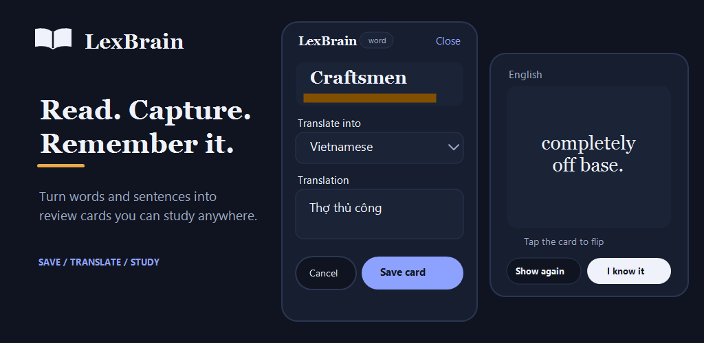

# 🧠 LexBrain

> **Turn anything you read into flashcards.**

Select a word, sentence, or paragraph while reading. LexBrain translates it, captures the context, and helps you remember it with spaced repetition.

📱 **Android** · 🌐 **Chrome & Edge** · 🔒 **Local-first** · 🧠 **Spaced repetition**

**Select → Add to LexBrain → Save → Keep reading.**

LexBrain integrates directly with Android, Chrome, and Microsoft Edge, allowing you to capture vocabulary without interrupting what you are reading.

<p align="center">
  
</p>

## Why LexBrain?

You are reading an article, book, documentation page, or PDF and encounter a word you want to remember.

Normally, you have to:

1. Copy the word.
2. Open a translation app.
3. Translate it.
4. Open a flashcard or vocabulary app.
5. Create a card.
6. Return to what you were reading.

LexBrain turns that into:

**Select → Add to LexBrain → Save → Keep reading.**

Later, LexBrain brings the captured text back as a flashcard using spaced repetition.

Instead of learning vocabulary from arbitrary word lists, you learn from **things you actually read** and retain the context in which you found them.

---

## ✨ Features

### 📖 Capture while you read

Select text without leaving what you are reading.

On **Android**, LexBrain appears as **Add to LexBrain** in the text-selection menu and Android share sheet.

On **Chrome and Microsoft Edge**, select text and use the floating LexBrain button or right-click **Add to LexBrain**.

---

### 🌐 Translate instantly

LexBrain translates captured text before saving it.

You can review and edit the translation before creating the card.

LexBrain automatically detects whether the captured content is a:

- word
- sentence
- paragraph

> Translation currently uses Google's undocumented web Translate endpoint. It is not the supported Google Cloud Translation API and may change without notice.

---

### 📝 Remember the context

Vocabulary is easier to understand when you remember where you found it.

When you capture a single word using the browser extension, LexBrain automatically saves its surrounding sentence as context and highlights the captured word when you study it.

For example:

> Sometimes the best discoveries happen through **serendipity** rather than careful planning.

Instead of learning only:

**serendipity → a fortunate accidental discovery**

you retain the sentence in which you originally encountered it.

---

### 🧠 Learn with spaced repetition

LexBrain uses SM-2-based scheduling to decide when cards should appear again.

While studying, you can:

- 👆 Tap a card to flip it.
- 👉 Swipe right or tap **I know it** when the answer feels familiar.
- 👈 Swipe left or tap **Show again** to review it sooner.
- ↩️ Undo the last action from the toast that appears after a review.
- 🔊 Use the **Listen** button to hear either side with the device's text-to-speech engine.

Cards you already know are marked as **mastered** instead of being permanently deleted, so you can restore them later.

---

### 🔒 Keep your cards local

LexBrain does not require an account or cloud database for normal use.

The following data stays in the application's local IndexedDB database:

- saved cards
- original captured text
- translations
- context sentences
- study progress
- mastered cards
- translation cache

LexBrain does not upload your saved card library or study progress.

When translation is requested, the selected text is sent to Google's translation service.

> Cards currently do not sync between devices.

---

### 📱 Use it on phones and tablets

LexBrain provides responsive layouts for:

- phones
- tablets
- desktop browsers
- dark mode

Tablet mode provides a two-pane layout with the word library and study card visible together.

---

## 🚀 Project status

LexBrain is under active development.

| Capability | Status |
|---|---|
| Chrome extension build | ✅ Built and tested successfully |
| Microsoft Edge extension build | ✅ Built and tested successfully |
| Chrome text-selection capture | ✅ Working |
| Edge text-selection capture | ✅ Working |
| Chrome and Edge floating capture button | ✅ Working |
| Chrome and Edge context-menu capture | ✅ Working |
| Chrome built-in PDF viewer capture through the context menu | ✅ Working |
| Automatic context-sentence capture | ✅ Working |
| Translation | ✅ Working |
| Flashcards | ✅ Working |
| SM-2 spaced repetition | ✅ Working |
| Text-to-speech | ✅ Working |
| Local IndexedDB storage | ✅ Working |
| Translation cache | ✅ Working |
| Phone layout | ✅ Working |
| Tablet two-pane layout | ✅ Working |
| Dark mode | ✅ Working |
| Android APK build | ✅ Built successfully |
| Android APK installation | ✅ Installed successfully on a real device |
| Android app | ✅ Working on a real device |
| Android text-selection capture | ✅ Working on a real device |
| Android study review gestures | ✅ Working on a real device |
| Cloud sync | 🚧 Backend code exists but is not exposed in the app |
| iOS Share Extension | 📋 Planned |

---

## 📦 Install

LexBrain is currently a developer preview.

Packaged store releases are not available yet. Chrome, Edge, and Android builds currently need to be built from source.

### Requirements

- Node.js 22+
- pnpm 11+
- Android Studio for Android builds
- A JDK version compatible with the installed Capacitor version

Clone the repository and install the dependencies:

```bash
git clone https://github.com/trucbinh/lexbrain.git
cd lexbrain

pnpm install
```

Common development commands:

```bash
pnpm dev:mobile
pnpm build:mobile
pnpm build:ext
```

Run the checks:

```bash
pnpm test
pnpm typecheck
```

---

## 🌐 Chrome and Microsoft Edge

The LexBrain browser extension has been successfully built and tested on both Chrome and Microsoft Edge.

The extension supports:

- selecting text and sending it directly to LexBrain
- opening a floating **Add to LexBrain** action
- right-clicking selected text and choosing **Add to LexBrain**
- capturing the surrounding sentence for individual words
- translating and editing captured text before saving
- opening the LexBrain study and vocabulary library from the toolbar

### Build the extension

